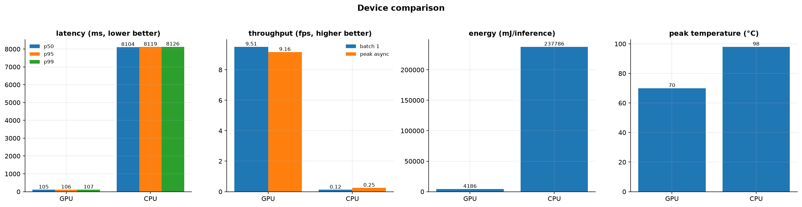
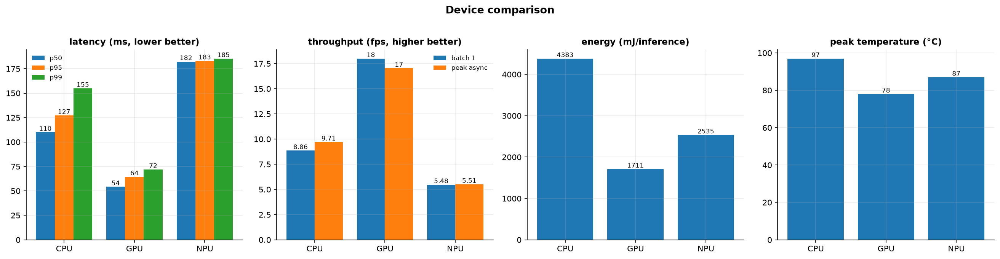

<div align="center">

# 🥐 Team Sfogliatelle — π cotta

**A LEGO brick inspection and sorting robot that runs entirely on one Intel laptop.**

[](#the-policy-%CF%8005)
[](#the-anomaly-detector-patchcore-on-good-bricks-only)
[](#5-intel-hardware-what-runs-where-and-why)
[](#5-intel-hardware-what-runs-where-and-why)
[](#heating-the-system-modal-b200s-and-35-training-jobs)
[](#datasets-316-teleoperated-episodes)

### ▶️ [Watch the demo](https://youtu.be/i87zoaiSM1U)

[](https://youtu.be/i87zoaiSM1U)

</div>

---

An **SO-101 robot arm** inspects LEGO Duplo bricks and sorts them into two dishes — good bricks to
the yellow one, defective bricks to the orange one. The policy that moves the arm, the model that
spots defects, and the operator dashboard all run **locally on one Intel Core Ultra X9 388H
laptop**. No cloud inference anywhere in the loop.

> **The number the project rests on:** π0.5 produces an action chunk in **105 ms on the iGPU** and
> **8 104 ms on the CPU**. The control loop needs one every 1 670 ms — so the iGPU uses 6.4 % of the
> budget while the CPU is 4.9× over it. That 77× gap is the difference between a working demo and a
> stalled arm. [Full numbers ↓](#5-intel-hardware-what-runs-where-and-why)

### Contents

| | Section | |
|---|---|---|
| 1 | [**What we do**](#1-what-we-do) | The three-stage cycle, demo clips, and what the model does that nobody taught it |
| 2 | [**Training and datasets**](#2-training-and-datasets) | 316 episodes, π0.5, PatchCore, and 35 Modal jobs |
| 3 | [**Code structure**](#3-where-the-code-is-and-how-it-is-structured) | Four packages and why their dependencies conflict |
| 4 | [**Physical AI integration**](#4-physical-ai-integration) | The `physicalai` library and the one patch we needed |
| 5 | [**Intel hardware**](#5-intel-hardware-what-runs-where-and-why) | Every benchmark number, CPU vs iGPU vs NPU |
| 6 | [**Operator dashboard**](#6-operator-dashboard) | The NiceGUI control panel |
| 7 | [**Running it**](#7-running-it) | Dry run, robot execution, configuration, tests |

---

## 1. What we do

One sorting cycle is three stages. The same π0.5 model performs all of them; only the text
instruction given to it changes.

| Stage | Instruction sent to the policy | Ends when |
|---|---|---|
| **Present** | `Move any brick to the center` | The inspection camera has seen a brick for 3 s continuously (`PRESENT_CONFIRM_S`) |
| **Inspect** | — (policy holds still) | PatchCore returns `GOOD`, `ANOMALY`, `EMPTY`, or an uncertain score |
| **Place** | `Move the brick to the yellow dish` / `…the orange dish` | The gripper closes on the brick and then opens again for 0.5 s |

After placing, the arm interpolates back to the pose it held before the first cycle, so the next
presentation does not start over the previous dish. Then it loops.

<details>
<summary><b>📹 Demo clips</b> — six recordings in <code>videos/</code></summary>

<br>

| Clip | What it shows |
|---|---|
| [`01-intro.mp4`](videos/01-intro.mp4) | The arm and the inspection camera |
| [`02-pick.mp4`](videos/02-pick.mp4) | Picking a brick up |
| [`02-place.mp4`](videos/02-place.mp4) | Placing it in the yellow dish |
| [`03-orange-tray.mp4`](videos/03-orange-tray.mp4) | The orange dish, where defective bricks go |
| [`04-full-run.mp4`](videos/04-full-run.mp4) | **A full uncut run** — plush unicorn distractor, bricks scattered everywhere |
| [`06-training.mp4`](videos/06-training.mp4) | Physical AI Studio: cameras, recorded episodes, the training run |

GitHub cannot play repo-local `.mp4` files inline, so these are download links. The
[YouTube demo](https://youtu.be/i87zoaiSM1U) is the one that plays in the browser.

</details>


*The inspection camera's RGB view beside PatchCore's heatmap. Drawing on a brick with a marker is
enough to push its score above the threshold — the model has never seen a marked brick, and it does
not need to have.*

The three task instructions live at the top of
[`sorting.py`](src/hackjunction2026_intel/sorting.py) and must match the wording used when
labelling the demonstration dataset. Changing the dataset means changing those strings.

### Generalization: the behaviours nobody demonstrated

The 316 training episodes carry exactly **five** task labels, and every one of them is a nominal
description of the job going right:

```
192  Move any brick to the center
 47  Move the brick to the yellow dish
 47  Move the brick to the orange dish
 18  Move the brick to the yellow plate
 12  Move the brick to the orange plate
```

There is no `recover the fallen brick`, no `try again`, no `pick from a pile`, no demonstration of
anything going wrong. Every episode is a teleoperator doing the task cleanly from a roughly
canonical starting layout. Despite that, π0.5 does several things at runtime that appear nowhere in
its demonstrations:

| Observed behaviour | Why it is out of distribution |
|---|---|
| **Picks from unseen positions** | Bricks placed outside the demonstrated start region still get picked. The policy was never shown those coordinates. |
| **Recovers a dropped brick** | If a brick falls or is knocked over mid-transport, the arm re-approaches and re-grasps it. There is not one `fallen → retake` episode — the training data contains no failures to imitate, so this cannot be a memorised recovery routine. |
| **Starts mid-task from an unseen pose** | Given `Move the brick to the yellow dish` while already holding a brick off-trajectory — say, over to the left — it goes straight to the dish instead of replaying the demonstrated path from its start. |
| **Selects from clutter** | With many bricks in frame it picks one and commits. Every demonstration had a single brick — `Single block to the center` is the literal name of the 170-episode dataset. |
| **Ignores distractors** | A plush unicorn dropped into the workspace does not derail it. Visible in [`04-full-run.mp4`](videos/04-full-run.mp4), one uncut take. |

This is the practical argument for a VLA over a scripted pick-and-place. A hand-coded routine needs
an explicit branch for "brick fell over", and a behaviour-cloning policy trained only on clean runs
would be expected to go off-distribution and stall. What the pretrained π0.5 backbone contributes is
the prior that makes "the brick is over there and I should grasp it" transfer to positions and
recoveries the fine-tune never covered — the 316 episodes teach *this* task on *this* arm, not every
situation it has to survive.

> [!NOTE]
> **Two honest caveats.** These are **observed behaviours from live runs, not a measured success rate** —
> we have no held-out generalization benchmark, no trial counts, and no failure tally, so "it
> recovers dropped bricks" means we watched it do so, not that it does so reliably. And the anomaly
> detector generalizes in the *opposite* direction by design: PatchCore flags anything unfamiliar,
> so the pinned camera settings in [`config.yaml`](anomaly_detection/config.yaml) exist precisely to
> stop it treating a lighting change as a defect.

## 2. Training and datasets

### Datasets: 316 teleoperated episodes

Every episode is a teleoperated demonstration recorded in **Intel Physical AI Studio**, which drives
the SO-101 over serial, previews and records the cameras, and stores each take with the text
instruction it demonstrates. Counts are live from the Studio API
(`GET /api/dataset/{id}/episodes`):

| Dataset | Episodes | Notes |
|---|---:|---|
| **`merged-dataset`** | **316** | ⬅ what the final policy trains on — everything below, merged |
| `Single block to the center` | 170 | 101 present · 34 yellow · 35 orange |
| `Main-moves-relabeled` | 146 | 91 present · 31 yellow · 24 orange |
| `Main moves` | 76 | The original take, before relabelling |
| `Pija o blocchettoooooo daiiiiiii` | 30 | First session, wording not yet fixed |
| `Very clean dataset` | 5 | |
| `Friendly moves` | 3 | `Say hi` — used for a SmolVLA side experiment |

The relabelling matters more than it sounds. The early datasets had the same behaviour split across
differently worded instructions — "Take the red square brick and put it on the yellow dish" (21
episodes) versus "Pick up the red square brick and put it into the yellow dish" (8) versus "Take the
red brick and put it in the yellow dish" (1). A VLA model conditions on that string, so three
spellings of one task means three tasks with a third of the data each. `merged-dataset` still
carries a `dish`/`plate` split (47 yellow dish + 18 yellow plate, 47 orange dish + 12 orange plate)
for the same reason. The three strings in
[`sorting.py`](src/hackjunction2026_intel/sorting.py) must match the labels exactly, which is why
they are constants at the top of the file rather than inline strings.

### The policy: π0.5

The policy is a pretrained **π0.5** vision-language-action model fine-tuned on `merged-dataset`. A
VLA model takes camera frames plus a text instruction and outputs a chunk of joint positions, so one
network covers all three stages and "pick up the orange brick instead" is a prompt change rather
than a retrain.

Training settings, identical across every attempt: **5 epochs**, `bf16-mixed` precision,
`compile_model: true`, image augmentation on, `val_split: 0.1`, SnapFlow distillation for 3 epochs,
and `export_backends: ["openvino"]` so Studio hands back OpenVINO IR directly. Batch size moved
8 → 16 → 32 depending on the GPU. π0.5 also needs Hugging Face access to the gated
`google/paligemma-3b-pt-224` as its vision-language backbone, via `HF_TOKEN` in `infra/.env`.

### Heating the system: Modal B200s and 35 training jobs

Studio can train locally, but π0.5 is a 3B-parameter backbone — the laptop's iGPU is an inference
device, not a training one. So Studio was pointed at **Modal**, which rents GPUs per second, and we
burned through **35 training jobs in about 29 hours** across five GPU tiers: A10G, A100-80GB, H100,
and **B200** — Nvidia's Blackwell data-center part, the fastest thing Modal rents.

Three automation skills in [`.github/skills/`](.github/skills) exist because the Studio UI is a bad
place to live when jobs fail this often. They drive Studio's REST API at `roberta:7860/api` directly:

| Skill | What it does |
|---|---|
| [`studio-inspect-resources`](.github/skills/studio-inspect-resources/SKILL.md) | Lists projects, datasets with per-task episode counts, models, exports, trainers, policies, devices — the episode table above is its output |
| [`studio-launch-training`](.github/skills/studio-launch-training/SKILL.md) | `POST /api/jobs:train` with a full payload; clones a previous job's settings and changes one field |
| [`studio-monitor-training`](.github/skills/studio-monitor-training/SKILL.md) | Polls job status, distinguishes stalled from working via Docker and `modal container list`, cancels and cleans up |

Submitting to the B200 has one non-obvious requirement, documented in the launch skill: it is a
*separate trainer ID* (`22f86c1e-…`) rather than a GPU choice, and `modal_gpu` must be `null`,
because Studio's GPU enum does not contain `B200` — the trainer pins the hardware itself. Asking
for `modal_gpu: "B200"` on the generic Modal trainer is rejected.

**What actually happened is worth recording honestly: of 35 jobs, 8 completed.** Every π0.5 run on
the B200 failed or was canceled.

<details>
<summary><b>The six B200 π0.5 attempts, and how each died</b></summary>

<br>

| Attempt | GPU | Reached | Outcome |
|---|---|---|---|
| π0.5 · Main-moves-relabeled | B200 | 5 % | Cloudflare R2 DNS failure |
| π0.5 · Main-moves-relabeled | B200 | 5 % | Aborted, application shutdown |
| π0.5 · Main-moves-relabeled | B200 | **95 %** | `clobber.modal-storage.com` unresolvable — died downloading the finished model |
| π0.5 · Single block · "Ricotta" | B200 | **95 %** | Canceled after 151 min |
| π0.5 · merged-dataset | B200 | 10 % | Canceled |
| π0.5 · merged-dataset (retry) | B200 | 10 % | Canceled |

</details>

Two separate runs reached 95 %, trained for over two hours of B200 time, and then lost the model on
the way home: Studio's "Downloading trained model from Modal" step could not resolve Modal's storage
host from the robot. The failures were never the GPU and never the training — they were a gated
Hugging Face repo (401/403 on `paligemma-3b-pt-224`), Modal's **workspace billing spend limit**
being hit mid-run, and DNS on the robot host. The B200 did finish other policies on the same
dataset: **SmolVLA in 58 min** and **ACT in 51 min**, both completed and exported.

The run that produces the final policy is **`Pi0.5 - final`** — `merged-dataset`, 316 episodes, batch
size 16, on an **H100** rather than a B200, after the B200 attempts kept losing their results at the
download step.

> [!WARNING]
> **Status at the time of writing:** `Pi0.5 - final` is still *running* at 46 %, and Studio's
> trained-models list holds only SmolVLA and ACT exports — no π0.5 job has ever reached `completed`.
> A usable π0.5 OpenVINO export nonetheless exists on the robot at
> `~/Downloads/pi05-ricotta-runtime`: 6 252 MB of weights, a 50×6 action chunk, two camera inputs.
> That is the export section 5 benchmarks and the one driving the arm, and its name says it came out
> of the "Ricotta" B200 run that Studio records as canceled at 95 %. The export survived; Studio's
> bookkeeping of it did not. Check `GET /api/jobs` for the current state before citing this section.

### The anomaly detector: PatchCore on good bricks only

**PatchCore** (Anomalib 2.7) learns what a *good* brick looks like and flags anything that does not
fit. It is not a classifier — it never sees a labelled defect during training. It stores patch
features from good images in a memory bank, and at inference scores a new patch by its distance to
the nearest stored neighbours. A high distance means "I have never seen this texture here", which
covers scratches, marker drawings, and wrong colours without ever enumerating them.

The shipped model (`anomaly_detection/models/patchcore-v2/metadata.json`) was trained on:

| Split | Count | Role |
|---|---|---|
| `train/good` | 181 | The PatchCore memory bank |
| `train/empty` | 20 | Median background reference for the "is there a brick at all" check |
| `test/good` | 45 | Held out — never in the memory bank |
| `test/anomaly` | 57 | Held out, used only to set the threshold and report stats |
| `test/empty` | 5 | Held out |

Held-out test results, from Anomalib on the 102 good+anomaly test images:

| Metric | Value |
|---|---|
| Image AUROC | **1.000** |
| Image F1 | **0.991** |
| Empty-vs-brick separation | empty scores max **0.013**, bricks min **0.198** — a 15× gap, threshold at 0.106 |

AUROC 1.0 means every anomalous image scored higher than every good image, so there exists a
threshold with zero errors on this test set. That is a small, single-setup test set with locked
camera controls, not a claim about bricks in general lighting — the ROI crop, focus, exposure, gain
and white balance are all pinned in [`config.yaml`](anomaly_detection/config.yaml) precisely because
PatchCore treats a lighting change as an anomaly too.

The empty check is deliberately not the network: each crop is compared to the median of the 20
empty-ROI frames, which takes under 1 ms, and PatchCore only runs if a brick is actually there.

Training is cheap because PatchCore only extracts features and never backpropagates — a CPU-only
torch build fits the model in a minute or two. [`modal_train.py`](anomaly_detection/modal_train.py)
runs the identical `train()` on a Modal T4/L4 when you want it faster.

Studio in action during training: [`videos/06-training.mp4`](videos/06-training.mp4).

## 3. Where the code is, and how it is structured

Three installable Python packages plus a benchmark harness. They are separate because their
dependencies genuinely conflict: Anomalib 2.7 needs `jsonargparse<4.47` and `physicalai` needs
`>=4.50`, so [`pyproject.toml`](pyproject.toml) declares them as mutually exclusive
(`conflicts = [[{extra = "robot"}, {package = "brick-ad"}]]`) and each gets its own environment.

```
hackjunction2026-intel/
├── src/hackjunction2026_intel/        ← robot runtime  (uv sync --extra robot)
│   ├── sorting.py          300 ln   task strings, durations, export validation, the 3-stage cycle
│   ├── run_model.py        578 ln   PolicyRunner: loads policy + robot once, reuse across stages
│   ├── persistent_model.py  17 ln   keeps the model loaded across RobotRuntime.run() calls
│   ├── run_task.py          62 ln   run one arbitrary instruction
│   └── anomaly_detection/           inference-only side of the detector, shared by both envs
│       ├── station.py     108 ln   InspectionStation: owns the camera + model lifecycle
│       ├── inspector.py   129 ln   BrickInspector: crop → presence → PatchCore → verdict
│       ├── presence.py     55 ln   the sub-millisecond empty-ROI check
│       ├── decision.py     56 ln   score + threshold + margin → GOOD / DEFECTIVE / ROTATE / EMPTY
│       └── imaging.py      50 ln   ROI crop and resize
│
├── anomaly_detection/                 ← training tools, `brick-ad` CLI  (uv sync --package brick-ad)
│   ├── config.yaml                  camera source, locked controls, ROI, model + inference settings
│   ├── modal_train.py       91 ln   same training function, on a Modal GPU
│   ├── models/patchcore-v2/         the shipped OpenVINO IR + metadata.json (Git LFS)
│   └── src/brick_ad/
│       ├── cli.py         140 ln   cameras · stream · roi · lock · collect · prepare · train · …
│       ├── capture.py     176 ln   interactive frame collection with burst mode
│       ├── lock.py        160 ln   measures and pins focus/exposure/gain/white-balance
│       ├── dataset.py      77 ln   ROI crop + resize + train/test split
│       ├── train.py       122 ln   fit PatchCore, export OpenVINO, calibrate the empty check
│       └── evaluate.py    145 ln   confusion matrix, AUROC, F1, margins, per-file mistakes
│
├── operator_gui/                      ← NiceGUI dashboard  (add-on; delete the folder to remove)
│   └── src/operator_gui/
│       ├── controller.py  391 ln   auto-cycle state machine, drives run_model unchanged
│       ├── ui/widgets.py  487 ln   camera panel, verdict + heatmap, counters, brick history table
│       ├── telemetry.py   261 ln   per-device latency / throughput / thermals in the UI
│       ├── runner.py      178 ln   subprocess that owns the policy
│       └── dryrun.py       74 ln   simulated robot + camera + random verdicts, no hardware
│
├── benchmark/                         ← performance only, no accuracy
│   ├── bench_core.py                PatchCore across CPU / iGPU / NPU
│   ├── bench_vla.py                 π0.5 and ACT across devices, with real-time verdicts
│   └── results/                     JSON + CSV + generated plots
│
├── .github/skills/                    ← Studio REST API automation (see section 2)
│   ├── studio-inspect-resources/    list datasets + per-task episode counts, models, trainers
│   ├── studio-launch-training/      POST /api/jobs:train, incl. the B200 trainer's quirks
│   └── studio-monitor-training/     poll status, detect stalls, cancel, clean up
│
├── infra/docker-compose.yml           the Physical AI Studio container
└── videos/                            demo clips, shot list, and the presentation deck
```

The design rule throughout: **the GUI and the benchmarks are add-ons that call the robot code as it
is.** `operator_gui` builds one `PolicyRunner` and calls `run_model.run_cycle` in a loop; it patches
nothing. Deleting either folder leaves a working robot.

## 4. Physical AI integration

The robot side is built entirely on **[`physicalai`](https://github.com/openvinotoolkit/physicalai)**,
Intel's open-source Python library for physical-AI robots — the same library Physical AI Studio
uses underneath. We pin it by commit in [`pyproject.toml`](pyproject.toml):

```toml
robot = [
  "physicalai[capture,transport] @ git+https://github.com/openvinotoolkit/physicalai.git@8381d439",
  "physicalai-so101-plugin~=0.3.0",     # the SO-101 arm driver
  "physicalai-studio-plugin~=0.5.0",    # Studio dataset / export integration
]
```

Three pieces of its API carry the whole runtime:

```python
from physicalai.config import Config          # loads Studio's exported runtime.yaml
from physicalai.runtime import RobotRuntime   # the control loop: cameras → policy → joint commands
from physicalai.inference import InferenceModel   # the OpenVINO-backed policy wrapper
```

**`Config`** parses the `runtime.yaml` that Studio generates next to the OpenVINO export.
[`sorting.py`](src/hackjunction2026_intel/sorting.py) validates it before anything moves — it checks
that `class_path` really is `physicalai.runtime.RobotRuntime`, that it contains a `PolicySource` with
an `InferenceModel`, and that `init_args` exists. A malformed export fails at startup rather than
mid-motion with the arm holding a brick.

**`RobotRuntime`** owns the 30 Hz loop: it opens the cameras and the serial port, builds the
observation, calls the policy, and writes joint targets. We do not reimplement any of it. What we do
override is the export's settings in memory: the model is pointed at `exports/openvino/` inside the
export, `backend` is forced to `openvino`, and the OpenVINO device comes from `OPENVINO_DEVICE` in
`sorting.py` (default `AUTO`) — whatever device was picked in Studio's export dialog is ignored, and
`runtime.yaml` on disk is never rewritten.

**`PersistentInferenceModel`** ([17 lines](src/hackjunction2026_intel/persistent_model.py)) is the
one real patch. `RobotRuntime.run()` closes its `InferenceModel` when it returns, which is correct
for a single task but means a three-stage cycle would reload π0.5 three times — and π0.5 takes
**12.5 s to compile cold** and 1.4 s warm. Subclassing `InferenceModel` to ignore `close()` lets us
load the policy once, connect the robot once, and swap only the instruction between stages. The
model is freed when the process exits.

The inspection camera is deliberately kept *out* of `runtime.yaml`: only the inspection code may
open it, because a V4L2 device allows exactly one reader. Likewise, Studio's own camera preview has
to be closed before `brick-ad` can see the camera at all.

## 5. Intel hardware: what runs where, and why

The whole stack targets one chip — an **Intel Core Ultra X9 388H** (Panther Lake, 16 cores) with a
**B390 iGPU** and an **NPU**. Both models are OpenVINO IR, so picking an engine is one string, and
the interesting question is which model belongs where. Everything below is measured; nothing is
estimated.

### The four benchmark runs

| Run file | Model | Weights | Chunk | Devices | Host | Iters / sustain |
|---|---|---|---|---|---|---|
| [`result_20261115_000405`](benchmark/results/result_20261115_000405.json) | PatchCore | — | — | CPU · iGPU · NPU | Core Ultra X9 388H | 9 buckets |
| [`vla_20261115_055046`](benchmark/results/vla_20261115_055046.json) | **π0.5** (`pi05.xml`) | **6 252 MB** | 50 actions | iGPU · CPU | Core Ultra X9 388H | 60 iters / 300 s |
| [`vla_20261115_062310`](benchmark/results/vla_20261115_062310.json) | ACT (`act.xml`) | 137 MB | 100 actions | iGPU · CPU · NPU | Core Ultra X9 388H | 60 iters / 300 s |
| [`vla_20261115_054300`](benchmark/results/vla_20261115_054300.json) | ACT (`act.xml`) | 137 MB | 100 actions | iGPU only | i7-12700H (comparison) | 20 iters / 25 s |

All four ran OpenVINO `2026.4.1`, Python 3.13, on AC power with `cpu_governor: powersave` and
`energy_perf_pref: performance`. The π0.5 run used the export at
`~/Downloads/pi05-ricotta-runtime` — the "Ricotta" B200 run from section 2. Its inputs are a 6-DOF
state vector plus two cameras (RealSense RGB at 3×720×1280 and a gripper cam at 3×600×800); it
outputs a 50×6 action chunk.

### Complete results: every device, every metric

#### π0.5 — the shipped policy

<sub>`vla_20261115_055046_summary.csv` · 6 252 MB weights · 50-action chunk · 60 iters, 300 s sustain</sub>

| Metric | 🟢 iGPU (fp16) | 🔴 CPU (fp32) |
|---|---|---|
| p50 latency | **104.95 ms** | 8 103.69 ms |
| p95 latency | 106.47 ms | 8 118.84 ms |
| p99 latency | 106.76 ms | 8 126.21 ms |
| Sequential FPS | 9.508 | 0.123 |
| Peak FPS | 9.164 | 0.246 |
| **Actions/s** | **476.4** | 6.2 |
| Duty cycle at p99 | **6.41 %** | 487.57 % |
| Max control rate at p99 | **468.3 Hz** | 6.2 Hz |
| **Real-time at 30 Hz?** | **yes** | **no** |
| Cold compile | 12 481.8 ms | 6 083.1 ms |
| Warm compile | 1 398.1 ms | 1 379.8 ms |
| First inference | 129.1 ms | 8 041.6 ms |
| **Energy per inference** | **4 185.7 mJ** | 237 786.3 mJ |
| Sustained drop over 300 s | 27.5 % | 0.3 % |
| Peak package temp | 70 °C | 98 °C |

#### PatchCore — the anomaly detector

<sub>`result_20261115_000405_summary.csv` · 9 sustain buckets</sub>

| Metric | CPU (fp32) | 🟢 iGPU (fp16) | 🔵 NPU (deployed) |
|---|---|---|---|
| p50 latency | 109.97 ms | **54.28 ms** | 182.35 ms |
| p95 latency | 127.21 ms | 64.47 ms | 183.07 ms |
| p99 latency | 154.91 ms | 72.06 ms | 185.39 ms |
| Sequential FPS | 8.86 | **18.0** | 5.48 |
| Peak FPS | 9.71 | 17.04 | 5.51 |
| Cold compile | 657.5 ms | 1 483.8 ms | **17 089.0 ms** |
| Warm compile | 106.1 ms | 149.3 ms | **40.1 ms** |
| First inference | 172.6 ms | **99.9 ms** | 373.7 ms |
| **Energy per inference** | 4 383.1 mJ | **1 710.8 mJ** | 2 535.1 mJ |
| Sustained drop | −1.5 % | 4.6 % | −0.1 % |
| Peak package temp | **97 °C** | 78 °C | 87 °C |
| End-to-end p50 (incl. pre/post) | 126.04 ms | **91.51 ms** | 184.84 ms |

<details>
<summary><b>ACT across all three engines</b> — not the shipped policy, but the only model that ran on CPU, iGPU <i>and</i> NPU</summary>

<br>

<sub>`vla_20261115_062310_summary.csv` · 137 MB weights · 100-action chunk</sub>

| Metric | iGPU (fp16) | CPU (fp32) | NPU |
|---|---|---|---|
| p50 latency | **2.70 ms** | 86.91 ms | 5.69 ms |
| p95 latency | 2.79 ms | 104.50 ms | 6.36 ms |
| p99 latency | 3.05 ms | 120.61 ms | 6.61 ms |
| Sequential FPS | **367.4** | 11.2 | 173.8 |
| Peak FPS | 356.6 | 21.3 | 216.2 |
| **Actions/s** | **37 003.4** | 1 150.6 | 17 588.2 |
| Duty cycle at p99 | 0.09 % | 3.62 % | 0.20 % |
| Max control rate at p99 | 32 837 Hz | 829.2 Hz | 15 132 Hz |
| Real-time at 30 Hz? | yes | yes | yes |
| Cold compile | 3 263.3 ms | **613.3 ms** | 1 649.9 ms |
| Warm compile | 255.3 ms | 181.9 ms | **36.3 ms** |
| First inference | 6.6 ms | 86.6 ms | 26.1 ms |
| **Energy per inference** | **68.5 mJ** | 2 667.0 mJ | 157.3 mJ |
| Sustained drop | 23.7 % | 16.3 % | **−51.8 %** |
| Peak package temp | 93 °C | 95 °C | **73 °C** |

</details>

**Cross-platform check** — the same ACT IR on a 12th-gen i7-12700H iGPU
(`vla_20261115_054300_summary.csv`): 33.0 ms p50, 31.4 FPS, 3 029.9 actions/s, 1.13 % duty, cold
compile 1 451.3 ms, peak 60 °C. The Panther Lake iGPU runs the identical model at 2.70 ms —
**12.2× faster** than the two-generations-older part.

### What the numbers mean

**π0.5 on the CPU is not slow, it is non-functional.** A 30 Hz control loop consuming 50-action
chunks needs one chunk every 1.67 s. The iGPU delivers one in 105 ms — 6.4 % of the budget, leaving
a 468 Hz ceiling. The CPU takes 8.10 s, which is 4.9× *over* budget: the action queue drains, the
arm finishes its chunk and waits ~6.4 s for the next one. The benchmark's own verdict field says
`realtime_p99: False`. There is no tuning that closes a 77× gap. The iGPU is also **57× cheaper per
inference** (4.19 J vs 237.79 J) and peaks 28 °C cooler, which is why a laptop can run this all day.

**The 6 252 MB weights explain the 12.5 s cold compile**, and that is what
[`PersistentInferenceModel`](src/hackjunction2026_intel/persistent_model.py) exists to avoid paying
three times per cycle.

**PatchCore's iGPU win is real but unusable.** 54 ms beats the CPU's 110 ms and the NPU's 182 ms, at
the lowest energy (1.71 J) and temperature (78 °C) of the three. We still run it on the **NPU**
([`config.yaml`](anomaly_detection/config.yaml): `inference.device: NPU`), because the iGPU is
already committed to π0.5 and both models are live simultaneously while a brick is presented.
PatchCore runs a few times per cycle on a brick held still, so 182 ms is free — and moving it off
the iGPU protects the 105 ms the control loop depends on. The CPU alternative at 110 ms would work
too, but at 4.38 J and **97 °C** it heats the package the iGPU shares, which costs the policy
latency indirectly.

**The NPU's price is cold compile: 17.1 s**, 11× the iGPU's 1.48 s. Paid once at startup before any
motion, so invisible at runtime. Its warm compile is the fastest of the three (40 ms).

**Thermals and sustained load** (`*_sustained.csv`, 10 s buckets):

- π0.5 on the iGPU drops **27.5 %** over 300 s — 9.51 FPS in the first bucket, 6.90 in the last, package 77 → 72 °C. Real throttling, and still 7× the required rate.
- PatchCore is flat on every device (−1.5 %, 4.6 %, −0.1 %): too short per inference to heat anything.
- The NPU's **−51.8 %** "drop" on ACT is a speed-*up*: 165 FPS first bucket, 250 last, as its clocks ramp. Negative values in this column mean the last bucket beat the first.
- The CPU pins at 97–98 °C under both VLA loads and stays there.

### Plots

The two figures the hardware choice rests on:



<div align="center"><sub><b>π0.5, iGPU vs CPU.</b> The gap is the whole argument for the iGPU.</sub></div>

<br>



<div align="center"><sub><b>PatchCore on CPU, iGPU and NPU.</b> The iGPU wins — we deploy on the NPU anyway, see below.</sub></div>

<details>
<summary><b>📊 All 18 figures</b> — six per run, written by <code>plot_benchmark.py</code></summary>

<br>

| Figure | `plots_result_…` (PatchCore) | `plots_vla_…055046` (π0.5) | `plots_vla_…062310` (ACT) |
|---|---|---|---|
| Latency distribution | [png](benchmark/results/plots_result_20261115_000405/latency_distribution.png) | [png](benchmark/results/plots_vla_20261115_055046/latency_distribution.png) | [png](benchmark/results/plots_vla_20261115_062310/latency_distribution.png) |
| Latency over time | [png](benchmark/results/plots_result_20261115_000405/latency_over_time.png) | [png](benchmark/results/plots_vla_20261115_055046/latency_over_time.png) | [png](benchmark/results/plots_vla_20261115_062310/latency_over_time.png) |
| Power & temperature | [png](benchmark/results/plots_result_20261115_000405/power_temperature.png) | [png](benchmark/results/plots_vla_20261115_055046/power_temperature.png) | [png](benchmark/results/plots_vla_20261115_062310/power_temperature.png) |
| Sustained throughput | [png](benchmark/results/plots_result_20261115_000405/sustained_throughput.png) | [png](benchmark/results/plots_vla_20261115_055046/sustained_throughput.png) | [png](benchmark/results/plots_vla_20261115_062310/sustained_throughput.png) |
| Cold start | [png](benchmark/results/plots_result_20261115_000405/cold_start.png) | [png](benchmark/results/plots_vla_20261115_055046/cold_start.png) | [png](benchmark/results/plots_vla_20261115_062310/cold_start.png) |
| Device comparison | [png](benchmark/results/plots_result_20261115_000405/device_comparison.png) | [png](benchmark/results/plots_vla_20261115_055046/device_comparison.png) | [png](benchmark/results/plots_vla_20261115_062310/device_comparison.png) |

</details>

### Raw data layout

Every run writes five files. The CSVs are what the tables above are built from:

| File | Rows | Contents |
|---|---|---|
| `*_summary.csv` | one per device | Every metric in the tables above |
| `*_latencies.csv` | one per inference | Individual timings, for the distribution plots |
| `*_sustained.csv` | 10 s buckets | FPS, p50, p99, package and GPU temp over the sustain window |
| `*_traces.csv` | ~13 700 samples | Power, temperature and clock sampled throughout |
| `*.json` | — | Everything plus full environment, sensor, memory and model metadata |

### Reproducing

```bash
./benchmark/run_benchmark.sh --all --plot      # PatchCore: cpu + igpu + npu, with graphs
./benchmark/run_benchmark.sh --quick           # ~1 min sanity check
./benchmark/run_vla_benchmark.sh               # π0.5 / ACT across devices
```

`--sudo` enables RAPL package-energy measurement; without it the `mj_per_inference` column is empty.
Panther Lake device setup — `render`/`video` group membership, `intel-opencl-icd` for the iGPU, and
the NPU driver `.deb`s that are not in the Ubuntu repos — is in
[`benchmark/README.md`](benchmark/README.md).

## 6. Operator dashboard

[`operator_gui/`](operator_gui/README.md) is a NiceGUI app on port 8080 with the live camera and its
ROI box, the latest verdict and heatmap, running counts, a thumbnail table of every brick sorted,
per-device telemetry, an auto-cycle toggle, and a prompt for typing instructions straight to the
policy. It raises a loud alert the moment a defect is found.

```bash
uv run --with-editable ./operator_gui operator-gui --dry-run    # no hardware needed
```

The dry run simulates the robot, the camera, and the model with random verdicts at ~1.5 s per stage,
which is also how the UI gets developed away from the arm.

---

## 7. Running it

### Hardware-free dry run

From the project root, no `uv`, SDK, model export, or robot is needed:

```bash
PYTHONPATH=src python3 -m hackjunction2026_intel.sorting --dry-run
PYTHONPATH=src python3 -m unittest discover -s tests -v
```

The dry run logs presentation, a random inspection decision (the anomaly model is not used), and the selected placement without loading the SDK, the inspection camera, or connecting hardware. It allows zero durations. The tests exercise both sorting outcomes and failure handling. This does not validate model inference, calibration, camera access, serial permissions, or safe stage durations. Once downloaded, add `--export` to check the export's required file/folder layout; runtime configuration contents and model weights are still not validated.

On a host with the existing Studio image, a separate disposable container can reuse its Python and SDK without installing `uv` or rebuilding anything:

```bash
docker run --rm --network none --cap-drop ALL --security-opt no-new-privileges \
  --mount "type=bind,src=$PWD,dst=/workspace,readonly" \
  --workdir /workspace \
  --env PYTHONPATH=/workspace/src --env PYTHONDONTWRITEBYTECODE=1 \
  --entrypoint /app/application/backend/.venv/bin/python \
  physical-ai-studio-xpu:junction2026 \
  -m hackjunction2026_intel.sorting --dry-run
```

Replace the final module invocation with `-m unittest discover -s tests -v` to run the tests in that environment. This container has no host devices or Studio storage mounted and does not affect the running Studio service. It is deliberately unsuitable for real robot execution; hardware access and calibration mounts must be configured separately before supervised use.

### Robot execution

Install the robot dependencies and run from the project root on the robot host:

```bash
uv sync --extra robot
uv run --extra robot python -m hackjunction2026_intel.sorting --export ~/Downloads/model_openvino.zip
```

`--export` takes the zip downloaded from Studio (**Models** → model row → **OpenVINO** card → **Runtime export**) or its extracted folder. To swap models, pass a different export; nothing else changes. Zips are extracted to a temporary folder that is removed afterwards.

The optional robot dependencies match the runtime revision and SO-101/Studio plugin versions used by the Studio image in [docker-compose.yml](infra/docker-compose.yml).

The script opens the inspection camera and anomaly model (`InspectionStation`, see [anomaly_detection/README.md](anomaly_detection/README.md)) before any motion, then:

1. Runs the single multi-task π0.5 model with the presentation instruction. Presence checks start only after the first policy control tick has completed, not during model loading or connection. Presentation ends once inspection has been anything other than `EMPTY` continuously for `PRESENT_CONFIRM_S` (3 seconds); the robot then holds the brick in place. The check uses the same `EMPTY` rule as the inspection but skips the anomaly model, so it does not slow the policy. If that does not happen within `PRESENT_DURATION_S`, the cycle aborts
2. Inspects the brick with the anomaly model. `DEFECTIVE` and `GOOD` pick the placement; no brick (`EMPTY`) or an uncertain score (`ROTATE`) logs a warning and defaults to the defective dish in the standalone sorting script, even if no brick is present. The GUI and `run_model cycle` still abort on inconclusive results
3. Closes the inspection camera and runs the same model with the corresponding placement instruction until the SO-101 gripper grasps and then releases: it must first close at least 15 normalized points below the most open position seen (so opening to pick up the brick does not count), then open at least 15 points above its most closed position since that grasp for 0.5 seconds. The configured placement duration is a timeout; if the movement is not detected, the cycle aborts

After the movement is detected, the arm returns to the pose captured before the first cycle. Repeated cycles reuse that pose, so the next presentation does not start over the previous dish. This is an experimental heuristic: a regrasp during transport can trigger it before the arm reaches the dish, and it does not visually verify release or placement. Supervise the arm and keep a physical stop ready.

During placement, the release check logs the initial gripper position, sampled positions and timing, and a summary when the stage ends or is interrupted. These diagnostics use the existing gripper observations and do not change the completion condition.

The anomaly model must include the empty-ROI reference (`brick-ad fit-empty`): without it the model never reports `EMPTY`, so the cycle aborts before moving. The config comes from `$BRICK_AD_CONFIG`, else `anomaly_detection/config.yaml`, with the model chosen by `paths.model` there: `anomaly_detection/models/patchcore-v2/` (current, larger ROI) or `models/patchcore/` (v1). The model is versioned with Git LFS: run `git lfs install` before cloning, or `git lfs pull` afterwards. [docker-compose.yml](infra/docker-compose.yml) mounts both into the Studio container at `/brick` and sets `BRICK_AD_CONFIG`.

### Remote inspection demo

From the Mac, [run-inspection-demo.sh](scripts/run-inspection-demo.sh) connects to roberta and runs only the presentation and inspection stages. Its presence check also waits for the first policy control tick before starting. It uses `~/Downloads/pi05-ricotta-runtime` on roberta by default and saves the report to `~/Downloads/inspection.png`. Set `ROBERTA_HOST` or `EXPORT` to override the host or a directory/zip under roberta's Downloads; pass `--present-timeout` to override the default 45 seconds.

For the full presentation, inspection, and dish placement cycle, run [run-sorting.sh](scripts/run-sorting.sh) from the Mac. It uses the same host and export defaults and sets the presentation and placement timeouts to 45 seconds. Placement stops early when the gripper movement heuristic passes. `scripts/run-sorting.sh --dry-run` logs random routing without connecting to hardware.

Both scripts command the robot during a normal run. Before running them, stop competing Studio sessions, put the brick at its demonstrated starting position, clear the inspection area, and supervise the arm.

### Configuration

The task instructions in [sorting.py](src/hackjunction2026_intel/sorting.py) match the relabelled demonstration dataset:

- Presentation: `Move any brick to the center`
- Good placement: `Move the brick to the yellow dish`
- Defective placement: `Move the brick to the orange dish`

Before using hardware:

- If using a different dataset, update the task instructions to match its demonstrations
- Set `PRESENT_DURATION_S` (presentation timeout), `GOOD_DURATION_S`, and `BAD_DURATION_S` (placement timeouts) to positive, supervised-test values; zero prevents motion
- Set the inspection camera source in `anomaly_detection/config.yaml`, and keep that camera out of the export's `runtime.yaml`: only the inspection code may open it
- Check the export's `runtime.yaml` for the serial port, robot calibration, camera identities/names/settings, control rate, and any safety callbacks; lines marked `# CHANGE_ME` contain machine-specific device paths
- Ensure presentation ends in a state compatible with both placement instructions

The export must contain `runtime.yaml` (generated for model inference, not teleoperation) and `exports/openvino/`. The script always runs on OpenVINO: it points the model at `exports/openvino` inside the export, regardless of the working directory, and forces `backend: openvino` with the OpenVINO device set by `OPENVINO_DEVICE` in `sorting.py` (default `AUTO`, which lets OpenVINO pick the best local accelerator; set `CPU`, `GPU`, or `NPU` to pin one). The device chosen in the Studio export dialog is ignored. It also sets the task and removes any fixed policy name so the export's manifest determines it. All other runtime settings are preserved, and `runtime.yaml` is not rewritten. Other relative paths in the configuration resolve from the working directory; use absolute hardware/calibration paths when necessary.

The policy is loaded and the robot and cameras are connected once, at the first stage, and reused for every later stage and cycle; only the task changes between stages. Each stage still starts from a reset model and an empty action queue. The SDK closes the inference model at the end of every `RobotRuntime.run()`, so the export's `InferenceModel` is swapped for `PersistentInferenceModel` ([persistent_model.py](src/hackjunction2026_intel/persistent_model.py)), which ignores that close and is freed when the script exits. The runtime manages camera capture, observations, inference, and robot commands. After each stage and on exit, the script requests a hold at the measured joint positions; on exit it then disconnects the runtime. The calibrated SO-101 follower driver normally keeps torque enabled on disconnect; verify this behavior on your actual setup.

Runtime errors, early stops, and Ctrl+C abort the cycle rather than advancing to inspection or placement. Hold and cleanup are software requests, not guaranteed physical stopping or an emergency stop. Stop competing Studio sessions before running the standalone script.

Durations and the presentation timeout use the SDK's control-loop timing, not a hard wall-clock watchdog; slow inference can extend real elapsed time. Model loading is also outside the timed run, while the 3-second `EMPTY` check runs on wall-clock time starting only after the first policy control tick. The placement release check is a gripper-motion heuristic and does not verify dish occupancy or placement accuracy. Validate it under supervision and retain a physical emergency stop; unattended operation requires a sensor that verifies the brick in the target dish.

### Tests

Run the hardware-free tests from a Python environment using the standard library; robot dependencies are not required:

```bash
PYTHONPATH=src python -m unittest discover -s tests -v
```

---

<div align="center">

**Team Sfogliatelle** · Junction 2026 · built on
[Intel Physical AI Studio](https://github.com/openvinotoolkit/physicalai) + OpenVINO

<sub>π0.5 · PatchCore · SO-101 · Core Ultra X9 388H</sub>

</div>
