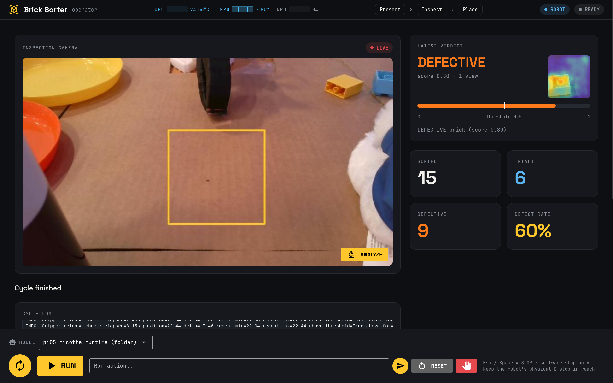

<div align="center">

# Ricotta Pi

**Second place in the [Intel Physical AI Challenge](guidelines/CHALLENGE.md) at [Junction 2026](https://hackjunction.app/hackathons/junction-2026)**

Team Sfogliatelle

[](https://youtu.be/i87zoaiSM1U)

[Watch the demonstration](https://youtu.be/i87zoaiSM1U)

</div>

Ricotta Pi is an autonomous inspection and sorting prototype built during Junction 2026. An SO-101
robot arm presents LEGO DUPLO bricks to a camera, identifies visual defects, and places each brick
in the corresponding dish.

The system combines a fine-tuned **π0.5 vision-language-action model** for robot control with
**PatchCore** for visual inspection. Both models run locally on an Intel Core Ultra X9 388H laptop
using OpenVINO. The robot policy was fine-tuned separately on NVIDIA B200 GPUs through Modal.

## How it works

1. **Present** — π0.5 moves a brick into the inspection area
2. **Inspect** — PatchCore scores the camera image for visual anomalies
3. **Sort** — π0.5 places the brick in the yellow dish if it is good, or the orange dish if it is defective

The same policy handles presentation and placement using different language instructions. During
demonstration runs, the arm also picked bricks from different positions, selected from clutter, and
re-grasped a dropped brick.



*The inspection camera image and the corresponding anomaly heatmap*

## Training and data

We recorded **316 teleoperated demonstrations** with Intel Physical AI Studio and used them to
fine-tune π0.5 on NVIDIA B200 GPUs through Modal. The demonstrations covered three task intents:

| Task | Episodes |
|---|---:|
| Present a brick for inspection | 192 |
| Place a brick in the yellow dish | 65 |
| Place a brick in the orange dish | 59 |
| **Total** | **316** |

[Watch the dataset recording video](videos/06-training.mp4). The raw demonstrations are not included
in this repository.

PatchCore was fitted on **181 images of good bricks**. Anomalib reported image AUROC **1.000** and
image F1 **0.991** on 45 good and 57 anomalous images; the same images were used for threshold
calibration. The inspection image data is not included in the repository.

## Local inference

We exported the models to OpenVINO and distributed the workloads across the laptop's integrated
accelerators: π0.5 on the **integrated GPU** and PatchCore on the **NPU**. Inference and robot
control run locally; the cloud GPUs were used for training.

The following model-only benchmark measured a 50-action π0.5 chunk with synthetic inputs:

| Device | Precision | Median inference time |
|---|---|---:|
| Intel integrated GPU | FP16 | **105 ms** |
| CPU | FP32 | **8,104 ms** |

The integrated GPU was approximately **77 times faster** in this comparison. The
[benchmark results](benchmark/RESULTS.md) include the measurement details, additional device
comparisons, and links to the recorded data.

## Operator dashboard

The [operator dashboard](operator_gui/README.md) provides the inspection camera feed, anomaly
heatmap, sorting counts, device telemetry, and controls for running the robot. It also has a
hardware-free simulation mode.

## Explore the project

The sorting sequence can be previewed without a robot or model export:

```bash
PYTHONPATH=src python3 -m hackjunction2026_intel.sorting --dry-run
```

The dry run simulates inspection decisions and does not perform model inference. Robot operation
requires a compatible model export and calibrated hardware. **Supervise the arm and keep a physical
emergency stop within reach.**

- [Robot operation and safety](docs/robot-operation.md)
- [System architecture](docs/architecture.md)
- [Anomaly detection](anomaly_detection/README.md)
- [Benchmark results](benchmark/RESULTS.md) and [benchmark setup](benchmark/README.md)
- [Operator dashboard](operator_gui/README.md)

The PatchCore model files and demonstration videos are stored with Git LFS.
