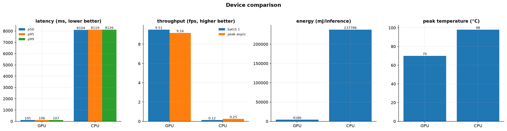
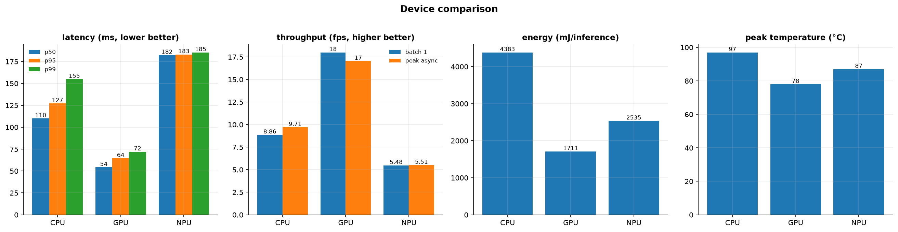

# Recorded inference benchmarks

These are the model inference measurements recorded during Junction 2026. The primary host was an
Intel Core Ultra X9 388H laptop running OpenVINO 2026.4.1 on AC power. The model timings use
synthetic inputs and measure OpenVINO inference rather than the complete robot control loop.

## π0.5 policy

The π0.5 OpenVINO export contained approximately 6,252 MB of weights and produced a 50-action
chunk. The run used 60 measured iterations and a 300-second sustained test.

| Metric | Integrated GPU, FP16 | CPU, FP32 |
|---|---:|---:|
| Median latency | 104.95 ms | 8,103.69 ms |
| p95 latency | 106.47 ms | 8,118.84 ms |
| p99 latency | 106.76 ms | 8,126.21 ms |
| Sequential inferences/s | 9.508 | 0.123 |
| Peak inferences/s | 9.164 | 0.246 |
| Actions/s | 476.4 | 6.2 |
| p99 duty cycle at 30 Hz | 6.41% | 487.57% |
| Theoretical control rate at p99 | 468.3 Hz | 6.2 Hz |
| Cold compile | 12,481.8 ms | 6,083.1 ms |
| Warm compile | 1,398.1 ms | 1,379.8 ms |
| First inference | 129.1 ms | 8,041.6 ms |
| Package energy per inference | 4,185.7 mJ | 237,786.3 mJ |
| Sustained throughput change | −27.5% | −0.3% |
| Peak package temperature | 70 °C | 98 °C |

At 30 Hz, a 50-action chunk represents approximately 1.67 seconds of actions. The duty cycle and
theoretical control rate are calculated from the model-only p99 latency.

[π0.5 results: JSON](results/vla_20261115_055046.json) ·
[summary CSV](results/vla_20261115_055046_summary.csv) ·
[all plots](results/plots_vla_20261115_055046/)

## PatchCore

The benchmark used the earlier `patchcore` model; the configured inspection model is
`patchcore-v2`. The run used 300 measured iterations and a 100-second sustained test.

| Metric | CPU, FP32 | Integrated GPU, FP16 | NPU |
|---|---:|---:|---:|
| Median latency | 109.97 ms | 54.28 ms | 182.35 ms |
| p95 latency | 127.21 ms | 64.47 ms | 183.07 ms |
| p99 latency | 154.91 ms | 72.06 ms | 185.39 ms |
| Sequential inferences/s | 8.86 | 18.0 | 5.48 |
| Peak inferences/s | 9.71 | 17.04 | 5.51 |
| Cold compile | 657.5 ms | 1,483.8 ms | 17,089.0 ms |
| Warm compile | 106.1 ms | 149.3 ms | 40.1 ms |
| First inference | 172.6 ms | 99.9 ms | 373.7 ms |
| Package energy per inference | 4,383.1 mJ | 1,710.8 mJ | 2,535.1 mJ |
| Sustained throughput change | +1.5% | −4.6% | +0.1% |
| Peak package temperature | 97 °C | 78 °C | 87 °C |
| End-to-end median, including pre/post-processing | 126.04 ms | 91.51 ms | 184.84 ms |

[PatchCore results: JSON](results/result_20261115_000405.json) ·
[summary CSV](results/result_20261115_000405_summary.csv) ·
[all plots](results/plots_result_20261115_000405/)

## ACT policy comparison

The ACT export contained approximately 137 MB of weights and produced a 100-action chunk. The
Core Ultra run used 60 measured iterations and a 300-second sustained test.

| Metric | Integrated GPU, FP16 | CPU, FP32 | NPU |
|---|---:|---:|---:|
| Median latency | 2.70 ms | 86.91 ms | 5.69 ms |
| p95 latency | 2.79 ms | 104.50 ms | 6.36 ms |
| p99 latency | 3.05 ms | 120.61 ms | 6.61 ms |
| Sequential inferences/s | 367.4 | 11.2 | 173.8 |
| Peak inferences/s | 356.6 | 21.3 | 216.2 |
| Actions/s | 37,003.4 | 1,150.6 | 17,588.2 |
| p99 duty cycle at 30 Hz | 0.09% | 3.62% | 0.20% |
| Theoretical control rate at p99 | 32,837 Hz | 829.2 Hz | 15,132 Hz |
| Cold compile | 3,263.3 ms | 613.3 ms | 1,649.9 ms |
| Warm compile | 255.3 ms | 181.9 ms | 36.3 ms |
| First inference | 6.6 ms | 86.6 ms | 26.1 ms |
| Package energy per inference | 68.5 mJ | 2,667.0 mJ | 157.3 mJ |
| Sustained throughput change | −23.7% | −16.3% | +51.8% |
| Peak package temperature | 93 °C | 95 °C | 73 °C |

The same ACT model recorded a median of 33.0 ms on an Intel Core i7-12700H integrated GPU.

[ACT results: JSON](results/vla_20261115_062310.json) ·
[summary CSV](results/vla_20261115_062310_summary.csv) ·
[all plots](results/plots_vla_20261115_062310/) ·
[i7 comparison](results/vla_20261115_054300.json)

## Data and reproduction

The [`results/`](results/) directory contains JSON, summary and per-inference CSVs, sustained-load
measurements, power and temperature traces, and generated plots. The benchmark scripts and device
setup are documented in the [PatchCore](README.md) and [VLA](README_VLA.md) guides.
